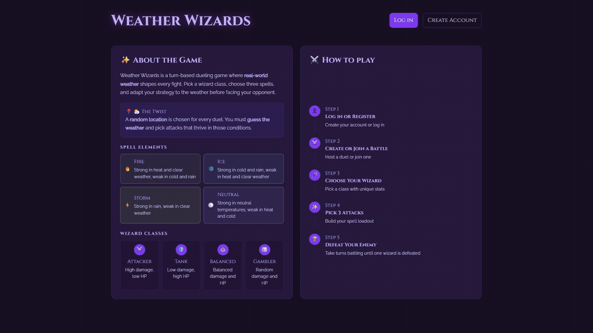
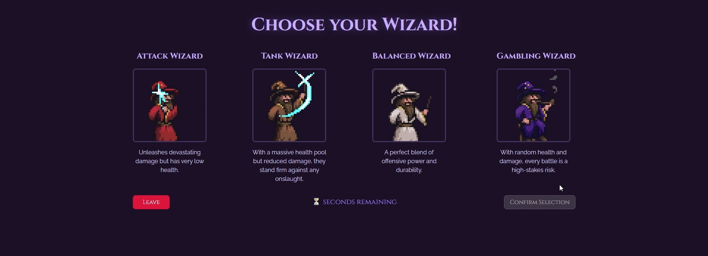
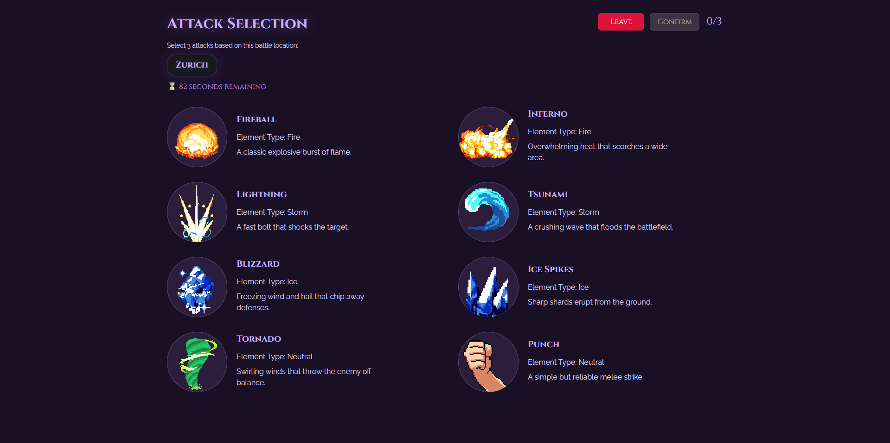

  

  <i style="font-weight: bold;">Weather Wizards</i>

<h4 align="center">

<h2 align="left">🧙 Introduction</h2> 
 Weather Wizards Introduction 
 
<h3 align="left">Goal</h3> 
 Goal 

<h3 align="left">Motivation</h3> 
 Motivation 

## Table of contents

- [Technologies](#technologies)
- [High-level components](#high-level-components)
- [Launch and Deployment](#launch-and-deployment)
- [Game Flow](#game-flow)
- [Roadmap](#roadmap)
- [Authors & Acknowledgements](#authors)
- [License](#license)

## Technologies
- **[Next.js](https://nextjs.org/)**
- **[React](https://react.dev/)**
- **[TypeScript](https://www.typescriptlang.org/)**
- **[Vercel](https://vercel.com/)**
- **[STOMP.js](https://stomp-js.github.io/stomp-websocket/)**
- **[SockJS](https://github.com/sockjs)**
- **[Ant Design (AntD)](https://ant.design/)**

## High level components

### [`Landing page`](./app/page.tsx)
tutorial & navigation to authentication

### Authentication - [`Login`](./app/login/page.tsx), [`Register`](./app/register/page.tsx)
login or register

### [`Lobby`](./app/lobby/page.tsx)
Lobby of the game with stuff

### Selection - [`Wizards`](./app/games/wizards/page.tsx), [`Attacks`](./app/games/attacks/page.tsx) 
First select wizard & then attacks

### [`Battle`](./app/games/battle/page.tsx)
Battle & Endscreen

### Header - [`Leaderboard`](./app/leaderboard/page.tsx), [`History`](./app/history/page.tsx)
Leaderboard, History, back to lobby

## Launch and Deployment

First you will need to clone the repository
`git clone https://github.com/SimiKid/sopra-fs26-group-02-client`

To Do: add instructions

## Game Flow

    

    

## Roadmap

- Customizable profile
- Cosmetics shop
- Sound

## Authors

|  |  |
|------|--------|
| Simone Martinecz |  |
| Liv Rusert |  | 
| Oliver Haas |  |
| Noel Gehrig |  |
| Sven Kariyawasam |  |

### Acknowledgement

Special thanks to our TA **[Lucio Canepa](https://github.com/luciocanepa)** who supported us during the making of Weather Wizards.

## License
We publish the code under the terms of the [Apache 2.0 License](https://github.com/SimiKid/sopra-fs26-group-02-server/blob/main/LICENSE) that allows distribution, modification, and commercial use. This software, however, comes without any warranty or liability.
